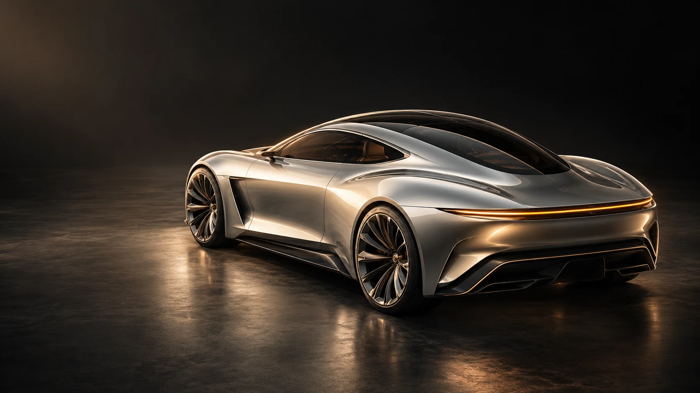

# VESPER / 01

A cinematic automotive design study with interactive finishes and detail exploration.

Автомобильная презентация: оригинальный AI-рендер, четыре световых этюда, три детали, экспорт выбранного варианта.



*Original AI-generated concept render (not a browser screenshot).*

## Explore

- [Public demo](https://safal207.github.io/vesper-automotive-concept/)
- [Portfolio and learning paths](https://safal207.github.io/test-it-python/ai-path/)
- [Scope, contribution and evidence](PORTFOLIO.md)

## Features

- Four visual grading treatments on one original render
- Three detail views with accessible pressed states
- Original/result comparison with three deterministic learning steps: source → color → detail
- Existing atelier controls update the live comparison, filter, crop scale and origin
- JSON export includes selected finish, detail and exact CSS/cropping parameters
- Responsive editorial layout and reduced-motion support

## Run locally

No package installation, API keys or CDN are required. Serve the static directory:

```bash
python3 -m http.server 8000 --directory dist
```

Open http://localhost:8000. Opening index.html directly as file:// is not supported because the application uses browser modules.

## Validate

```bash
npm run check
```

Checks cover local links, unique HTML IDs, JavaScript syntax and a DOM interaction harness for the transformation steps, comparison synchronization and downloadable settings. This is not a browser-rendering certification.

## Learn the transformation

Open [the process section](https://safal207.github.io/vesper-automotive-concept/#process). The left image stays unchanged. The three buttons set an unmodified source, a bronze color grade, and a crop of the rear light; the right image and atelier update together. Filter, scale and transform origin are shown beside the result. Manual atelier selections also update the comparison.

The initial image was generated with AI beforehand. The browser uses ordinary CSS filters and scaling on that one image; it does not run AI generation, construct a new camera angle, or change vehicle geometry. JSON export records reproducible settings, not an image file.

## Scope and limitations

- Fictional visual concept, not a production automobile.
- Finish selection is image grading, not a physically accurate paint configurator.
- No engineering specifications, customers or commercial results are claimed.

## Credits and licensing

Code and vector artwork are original project work, created with AI assistance. VESPER uses an original AI-generated fictional vehicle render.

Creative direction and implementation: Alexey Safonov, with AI assistance. Code under MIT; preserve all third-party notices. Inspiration: the supplied Meng To visual references. No commercial relationship or endorsement is implied.
